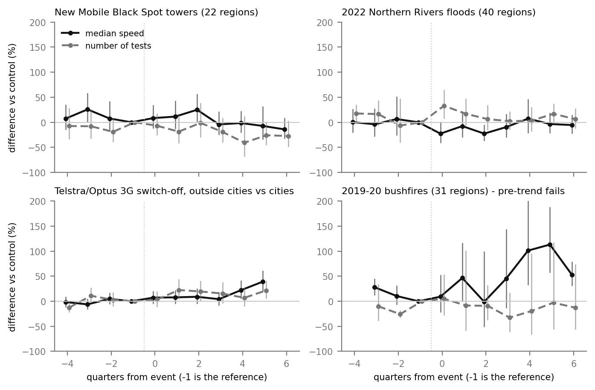

# O2: Events that changed the network

**Question.** How did new towers, the 3G switch-off, and the 2019–20 bushfires
and 2022 floods change measured mobile performance in New South Wales?

**Answer in one line.** Only two events leave a clear trace in quarterly
crowdsourced data: the 2022 floods (more tests, then slower speeds for about
half a year) and the Telstra/Optus 3G switch-off (non-city speeds rising
relative to cities a year later). New towers leave no measurable trace, and
the bushfire comparison fails its own validity check.



## Data

| Event | Source | What defines "touched" | Event quarter |
| --- | --- | --- | --- |
| New towers | [Mobile Black Spot Program](https://spatial.infrastructure.gov.au/server/rest/services/Mobile_Black_Spot_Program_Funded/MapServer/1), 341 NSW sites, 294 complete | a site completed within 10 km of the region centre, 2020 Q1 – 2025 Q2 | completion quarter |
| Bushfires | [NSW FESM 2019–20](https://data.gov.au/data/dataset/nsw-fire-extent-and-severity-mapping-fesm-2019-20), CC BY 3.0 AU | at least 3 of 9 sample points in a burnt severity class | 2019 Q4 |
| Floods | [NSW Reconstruction Authority](https://www.nsw.gov.au/departments-and-agencies/nsw-reconstruction-authority/northern-region/northern-rivers/about): the seven Northern Rivers LGAs; boundaries from ABS ASGS 2021 | region centre inside Ballina, Byron, Clarence Valley, Kyogle, Lismore, Richmond Valley or Tweed | 2022 Q1 |
| 3G switch-off | [Department of Infrastructure](https://www.infrastructure.gov.au/department/media/news/3g-network-switch-offs), [ACMA](https://www.acma.gov.au/3g-network-switch), [Optus notice](https://www.optus.com.au/content/dam/optus/documents/for-you/support/mobiles-tablets-wearables/important-changes-3g/switching-off-our-3G-network-simplified-english.pdf) | every region; non-city regions compared with city regions | TPG 2024 Q1; Telstra and Optus 2024 Q4 |

Speeds are Ookla's measured quarterly medians for all 455 NSW regions
(`data/panel_nsw.csv`), including the regional areas the O1 model cannot use.
Sources disagree on the Telstra/Optus date (28 October against November 2024);
both fall in 2024 Q4, so the disagreement does not affect a quarterly analysis.

## Method

An event study with region and quarter fixed effects:

```
log(y)_it = region_i + quarter_t + sum_k beta_k [t - event_i = k] + e_it
```

`beta_k` is how far touched regions moved relative to untouched ones `k`
quarters after the event, against the quarter before it. The region effect
removes each region's own level; the quarter effect removes everything that
moved the whole state at once - 5G rollout, seasons, Ookla's own changes.
Standard errors are clustered by region. Outcomes are median download speed
and number of tests, both logged.

Two choices decide the answer and are stated:

- **Measured, not shrunk, speeds.** O1 pulls each quarter toward a region's
  history to remove noise. That is right for ranking and wrong here, because it
  would pull an event's effect toward zero.
- **Rural controls for fires.** Burnt regions are compared with unburnt regions
  outside Sydney, Newcastle and Wollongong. Comparing them with cities that were
  rolling out 5G would read the 5G gap as fire damage.

A comparison is only believed if the touched and untouched regions moved
together **before** the event. Where they did not, the result is reported as
failed rather than interpreted.

## Results

| Event | Touched | Control | Before the event | After the event (significant quarters) | Valid? |
| --- | --- | --- | --- | --- | --- |
| New towers, 10 km | 22 | 393 | flat | nothing significant, speed or tests | yes |
| — 5 km / 20 km checks | 5 / 81 | 437 / 264 | flat | one noisy quarter at 5 km; nothing at 20 km | — |
| Floods 2022, speed | 40 | 119 | flat | **−23%** two quarters after | yes |
| Floods 2022, tests | 40 | 119 | one early quarter off | **+33%** in the flood quarter | mostly |
| 3G off, Telstra/Optus, speed | 361 | 94 | flat | **+22%** and **+39%**, four and five quarters after | yes, on an assumption |
| 3G off, Telstra/Optus, tests | 361 | 94 | one early quarter off | **+20–22%**, one, two and five quarters after | mostly |
| Bushfires 2019–20, speed | 31 | 296 | **already diverging** | large positive estimates late on | **no** |

Full coefficients: `results/coefficients.csv`; summary: `results/summary.csv`.

## What it means

**Floods.** In the quarter the Northern Rivers flooded, the number of speed tests
in the seven LGAs rose by a third relative to other northern regions, and two
quarters later median speed was 23% lower. Both had returned to the comparison
regions' path within about a year. More testing during the flood is people
checking a connection they were worried about; the later fall in speed is
consistent with damaged infrastructure carrying load while it was repaired.
Lismore, the worst-hit LGA, has only six regions and shows nothing on its own.

**3G switch-off.** Outside the cities, speeds rose relative to the cities by
22% and 39% a year after Telstra and Optus switched 3G off, with no gap
beforehand. This rests on an assumption the data cannot check: that 3G-only
devices were more common outside the cities. If it holds, the slowest devices
leaving the sample would lift non-city medians, so part of the "improvement" is
a change in who is measured rather than in the network. Regional 4G and 5G
upgrades in 2025 would produce the same pattern, and this design cannot
separate them. TPG's January 2024 switch-off is not identified separately: its
later quarters overlap the Telstra/Optus window.

**New towers.** Nothing measurable within 5, 10 or 20 km. That does not mean
the towers do not work. They are built in black spots, where there was no
coverage to measure; their users are new rather than faster, an ~8 km region's
median is set by the town tower that already served it, and Ookla only records
a black spot once someone runs a test inside it. The towers' benefit is
coverage, which speed medians are not built to see - O5 measures coverage
directly.

**Bushfires.** The comparison fails. Burnt regions were already moving away from
the controls in 2019 Q1, before the fire season, and the definition of "burnt"
changes the sign of the result: regions with any burn show −12% in the short
run, regions at least a third burnt show +26%. Nothing here measures what the
fires did. The burnt areas are mostly forested ranges with few tests, and the
outages they caused lasted days, which a quarterly median cannot see.

## Limits

- **Quarterly data cannot see outages.** An event lasting days is averaged
  into a quarter. Only lasting changes are visible.
- **Few touched regions.** 22 near towers, 31 burnt, 40 flooded, 6 in Lismore.
- **The 3G result depends on an untested assumption** about where 3G-only devices
  were.
- **Crowdsourced composition.** Who runs tests changes with events, as the flood
  and 3G test counts show. A change in median speed is partly a change in who
  is measuring.

## Reproduce

```bash
python experiments/events/scripts/fire_exposure.py   # samples FESM; ~3 min, network
python experiments/events/scripts/event_study.py     # all events -> results/
python experiments/events/scripts/figures.py         # results/event_study.png
```

`data/mbsp_nsw.json` and `data/flood_lgas_2022.geojson` were fetched from the
public services linked above; `data/region_fire.csv` and `data/fire_points.csv`
are derived from FESM. The FESM service labels unburnt pixels with a single
space, not an empty string; the first version of `fire_exposure.py` missed this
and counted 442 of 455 regions as burnt, which is why it now stores every
point's raw label.
