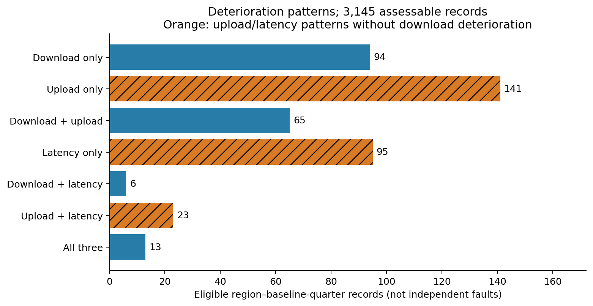
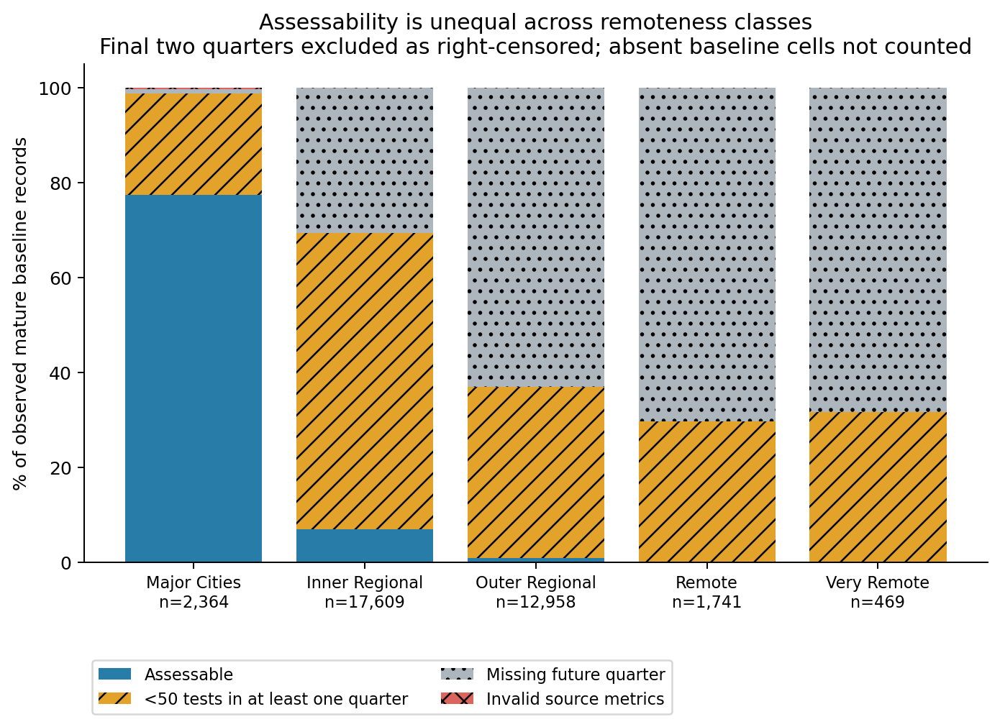

# Multi-metric mobile quality and official remoteness in NSW

Independent, retrospective evidence for the **mobile multi-metric / ABS-remoteness subset of O3**. This does not complete every O3 proposal, train a new predictor, alter teammates' work, or replace the group's existing outputs. Source snapshot: 2019Q1–2026Q1, retrieved 26 October 2026. Baseline repository: `ab85d42d99999ba238eb04bc18279e866f110384`.

Start with [the Chinese walkthrough](RESEARCH_LOG.zh-CN.md), [report-ready English draft](REPORT_SECTION.md), and [school requirements checklist](SCHOOL_CHECKLIST.md). The recorded [protocol](PROTOCOL.md) predates calculation of these outcomes.

## What was actually found

- Official centroid matching retained **37,449 observed grid-quarter records / 4,443 grids** in NSW. These are not SA2s, households or a complete map of NSW coverage.
- **3,145** baseline records, across **184** grids, met the common three-quarter eligibility rule.
- Download deterioration flagged **178** records. Upload or latency deterioration **without** download deterioration added **259** records, giving **437** records flagged by any metric.
- Additional records were **59.27% of flagged records** (259/437) and **8.24% of all eligible records** (259/3,145). They occurred in **125 distinct grids / 242 contiguous flagged runs**; runs are not independently verified incidents.
- Region-cluster bootstrap 95% interval for the additional share: **55.21%–63.17%** (1,000 draws, seed 2112). This interval does not repair selection bias or spatial dependence between different grids.
- Only **2** Remote records from **1** grid and **0** Very Remote records qualified. No all-five-class common-quarter comparison is possible. **Do not claim a reliable five-class ranking or that missing data mean good/bad service.**

| ABS group | Eligible records | Eligible grids | Assessable / observed mature records |
| --- | ---: | ---: | ---: |
| Major Cities | 1,829 | 79 | 77.37% |
| Inner Regional | 1,210 | 92 | 6.87% |
| Outer Regional | 104 | 12 | 0.80% |
| Remote | 2 | 1 | 0.11% |
| Very Remote | 0 | 0 | 0.00% |

The last column concerns records that actually exist at baseline, excluding the final two right-censored quarters. It is **not population coverage**, geographic coverage, or the percentage of residents with internet access.

## Definition

Aggregate public zoom-16 tiles to zoom-12 quadkeys using test-count-weighted arithmetic means. Match each grid centre uniquely to official ABS 2021 RA polygons (NSW codes 10–14). For baseline t, require exact t+1 and t+2 observations, all three metrics finite and positive, no invalid source tiles, and >=50 tests in **each** quarter.

Download/upload flag: both future values <=80% of the same baseline. Latency flag: both future values >=120% of baseline. Missing/invalid/low-count records retain unknown outcomes; final two baseline quarters are right-censored. These are exploratory relative-change definitions, not official service standards. They do not establish absolute adequacy, physical faults, carrier responsibility or household experience.

All six pre-specified alternatives were run: 15%, 25%, >=100 tests, latency also increasing >=5 ms or >=10 ms at both future quarters, and excluding mixed-RA tiles. Their additional shares span **51.23%–63.40%**. See [sensitivity.csv](results/sensitivity.csv).

## Reproduce (Python 3.12)

Run from the repository root in an isolated environment. Dependencies are pinned; this adds geospatial packages without changing the team's requirements file.

```bash
python3 -m venv .venv-quality
source .venv-quality/bin/activate
python -m pip install -r experiments/quality_fairness/requirements.txt
python experiments/quality_fairness/scripts/acquire.py --workers 2
python experiments/quality_fairness/scripts/analyse.py
python -m pytest experiments/quality_fairness/scripts/test_analysis.py -q
python experiments/quality_fairness/scripts/verify.py
```

Acquisition queries remote Parquet objects rather than downloading all worldwide data. It also downloads the official ABS boundary archive (about 30 MB). Cached aggregates are hash-checked. The published per-quarter CSVs allow analysis without fetching worldwide objects again, but ABS geometry is required for `analyse.py`. For a direct audit of included saved outcomes, `verify.py` needs no network or ABS download.

To re-query a fresh upstream snapshot without replacing the recorded evidence, use a separate checkout, then move the experiment's `data/quarters/` and `provenance/quarters/` directories to a backup location before running acquisition. Do not mix snapshot versions. Ookla may revise past aggregates, so different retrieval dates need not reproduce identical numbers.

## Files and evidence

| Path | Purpose |
| --- | --- |
| `scripts/acquire.py` | Independent official-source queries, weighted aggregation, URLs, SQL and hashes |
| `scripts/analyse.py` | Geography, eligibility, flags, denominators, comparisons, bootstrap and figures |
| `scripts/test_analysis.py` | Constructed boundary, missingness and geography tests |
| `scripts/verify.py` | Independent scalar reconstruction of every saved primary assessment |
| `data/quarters/`, `data/panel_bbox.csv` | Cached source aggregates before NSW matching and minimum-test filtering |
| `data/region_remoteness.csv`, `data/panel_nsw.csv` | Auditable geography mapping and NSW panel |
| `results/record_assessments.csv` | Each record's status, future values and nullable outcomes |
| `results/summary.csv` | Counts, denominators, rates, distinct grids, runs and cluster intervals |
| `results/quarter_rates.csv`, `results/equal_quarter_*.csv` | Same-quarter comparisons; empty all-class result is intentional |
| `results/first_example_each_pattern.csv` | First region/time example for each pattern, not largest-change examples |
| `results/verification.json`, `results/run_metadata.json` | Reconciliation and reproducibility checks |
| `figures/` | Four PNG/PDF figures; patterns support grayscale reading |
| `provenance/` | Acquisition URLs, object metadata, SQL, hashes and software versions |

`data/raw/` and `.cache/` are intentionally ignored. No model weights, secrets or private conversation transcripts are published. See [sources and data terms](DATA_SOURCES.md) and [AI assistance disclosure](AI_DISCLOSURE.md).

## Report figures





For the <=10-page group report, these two figures communicate the main contribution most efficiently. The other two figures are useful for supporting analysis or an appendix. Graph 2 hides bars with fewer than 30 records or 5 grids as a display safeguard; all estimates remain in the CSV. This plotting rule is not an official statistical sufficiency standard.
